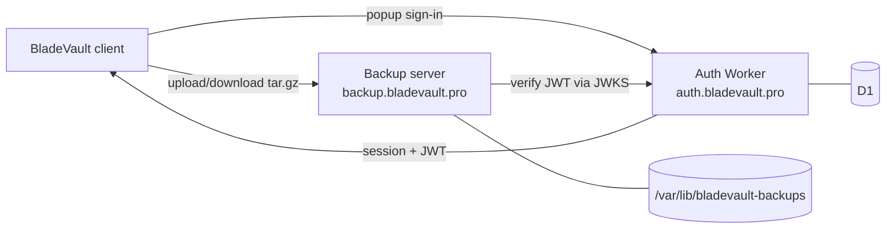

# BladeVault Backend

> **Archived.** This repository is published for reference only and is no longer maintained.

Backend services for BladeVault: a Cloudflare Worker that handles Google sign-in
and session/JWT issuance, and a small Node.js server that stores `tar.gz` backups
of each user's local `data/` folder, uploaded over HTTPS.

| Service | Runtime | Responsibility |
| --- | --- | --- |
| Auth Worker | Cloudflare Workers + D1 | Google OAuth, Better Auth sessions, popup handoff, JWT issuance, JWKS |
| Backup server | Node.js 20+ on Ubuntu | Verify JWTs, store/restore one latest archive plus history per user |



## What this is not

This repo does not implement knife CRUD, image uploads, or database sync. Those
live in the BladeVault client and in the client's local `data/` folder, which is
uploaded as a single archive.

## Repository layout

```text
src/                     Auth Worker (Hono + Better Auth)
  index.ts               Routes, popup flow, CORS
  auth.ts                Per-request Better Auth factory
  auth-options.ts        Better Auth configuration
  env.ts                 Env typing, origin matching, URL helpers
  sentry.ts              Scrubbed error reporting, logs, metrics
migrations/              D1 schema (Better Auth + JWKS keys)
backup-server/           Standalone Node.js backup API
  server.js              HTTP server, JWT verification, disk storage
  sentry.js              Scrubbed error reporting, logs, metrics
  scripts/               History retention cleanup
docs/                    Architecture and deployment guides
```

## Auth Worker

### Routes

| Method | Path | Purpose |
| --- | --- | --- |
| `GET` | `/` | Service banner |
| `GET` | `/api/health` | Health check |
| `GET` | `/api/me` | Current Better Auth user and session |
| `ALL` | `/api/auth/*` | Better Auth handler |
| `GET` | `/api/auth/jwks` | JWKS used by the backup server |
| `GET` | `/api/auth/token` | Short-lived JWT for the backup server |
| `GET` | `/auth/popup/start?client_origin=...` | Start Google sign-in for a popup client |
| `GET` | `/auth/popup/complete?client_origin=...` | Finish sign-in and post the payload to the opener |

`/auth/popup/complete` posts one of these payloads to the validated opener origin:

```json
{
  "type": "bladevault-auth-success",
  "accessToken": "<jwt for backup server>",
  "sessionToken": "<better-auth session token>",
  "expiresAt": "<iso timestamp>",
  "user": { "id": "user_id", "email": "user@example.com", "name": "Example User", "image": null }
}
```

```json
{ "type": "bladevault-auth-error", "error": { "message": "Sign-in failed." } }
```

### Configuration

Worker vars (committed in [`wrangler.jsonc`](wrangler.jsonc)):

- `APP_NAME`
- `AUTH_PUBLIC_BASE_URL`
- `ALLOWED_CLIENT_ORIGINS` — comma-separated exact origins or `*` / `?` wildcard patterns; local/private origins are always accepted
- `COOKIE_DOMAIN`

Worker secrets:

- `BETTER_AUTH_SECRET` (required)
- `GOOGLE_CLIENT_ID` (required for Google sign-in)
- `GOOGLE_CLIENT_SECRET` (required for Google sign-in)
- `BETTER_AUTH_API_KEY` (optional, enables Better Auth Dash)
- `SENTRY_DSN` (optional, enables error reporting)
- `SENTRY_ENVIRONMENT` (optional, defaults to `production`)
- `SENTRY_RELEASE` (optional; defaults to the `CF_VERSION_METADATA` binding)

Google OAuth client settings:

- Authorized JavaScript origin: `AUTH_PUBLIC_BASE_URL`
- Redirect URI: `${AUTH_PUBLIC_BASE_URL}/api/auth/callback/google`

### Database

D1 holds Better Auth tables plus JWT signing keys:

- `migrations/0000_better_auth.sql`
- `migrations/0002_better_auth_jwks.sql`

```bash
npx wrangler d1 migrations apply bladevault --local
npx wrangler d1 migrations apply bladevault --remote
```

### Local development

```bash
npm install
cp .dev.vars.example .dev.vars   # fill in the secrets
npm run dev
npm run typecheck                # tsc --noEmit
npm run cf-typegen               # regenerate worker types after config changes
```

### Deploy

```bash
npx wrangler secret put BETTER_AUTH_SECRET
npx wrangler secret put GOOGLE_CLIENT_ID
npx wrangler secret put GOOGLE_CLIENT_SECRET
npm run deploy
```

## Backup server

See [`backup-server/README.md`](backup-server/README.md) for the API, environment
variables, systemd unit, Caddy reverse proxy, and history-retention cron.

## Error reporting

Both services can report to Sentry, and both stay off until `SENTRY_DSN` is set.
Only unexpected failures (HTTP 5xx and crashes) are reported as errors, not 4xx.

| Service | Metrics |
| --- | --- |
| Auth Worker | `auth.signin.start`, `auth.signin.complete` (`result` = `ok`, `invalid_request`, `invalid_origin`, `start_failed`, `no_session`, `token_failed`) |
| Backup server | `backup.upload`, `backup.download` (`result` = `ok`, `too_large`, `empty`, `invalid_archive`, `not_found`, `error`), `backup.upload.size`, `backup.download.size`, `backup.auth.rejected` |

Reports never include headers, cookies, bodies, query strings (such as OAuth
`code` and `state`), user IDs, emails, file names, tokens, or JWTs. Text fields,
log lines, and metric attributes are scrubbed before sending. Tracing is disabled.

## License

[MIT](LICENSE)

## Docs

- [docs/architecture.md](docs/architecture.md)
- [docs/ubuntu-24-backup-server.md](docs/ubuntu-24-backup-server.md)
- [docs/migration-to-linux-backup-server.md](docs/migration-to-linux-backup-server.md)
- [docs/domain-migration-bladevault-pro.md](docs/domain-migration-bladevault-pro.md)
